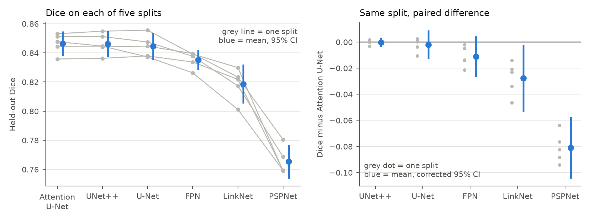

# The Architecture Comparison, Repeated Over Five Splits

Run: `python experiments/21_repeated_splits/run.py` (resumable; `--evaluate-only`
rescores existing bundles), then `python experiments/21_repeated_splits/figure.py`.
Outputs: `per_split.csv` (one row per split × architecture), `summary.csv` (mean,
SD, variance, min, max, 95% CI per metric), `results.json` (everything, including
both comparison families), `per_image_dice.npz`, `report_figure.png`.
Bundles (`bundles/seed<N>/`) and training logs (`logs/`) are not committed.

**Result.** Across five random splits the six architectures fall into two groups.
**U-Net, UNet++ and Attention U-Net cannot be separated**: their mean Dice is
0.8445–0.8464, they swap places from split to split, and no difference between
any two of them comes near significance (all p > 0.5). **FPN, LinkNet and PSPNet rank fourth, fifth and sixth in every
one of the five splits.** The published claim that LinkNet beats U-Net, UNet++, FPN
and PSPNet is not reproduced: LinkNet is worse than U-Net, UNet++ and FPN in all
five splits, significantly so even under a deliberately conservative test.

**One earlier conclusion does not survive.** On experiment 20's single split,
Attention U-Net beat U-Net (+0.0105 Dice, p = 0.007; 0.015 after correction).
Across five splits the difference is +0.0019, 95% CI [−0.0091, +0.0128],
p = 0.66, and U-Net finished first in three of the five splits. Attention U-Net
remains the selected architecture — nothing beats it — but it is not better than
U-Net.

> **Repeated on person-safe splits (experiment 24).** These splits let repeat
> shots of one subject sit on both sides (experiment 23). With every subject kept
> on one side, the order is the same and nothing beats Attention U-Net, but every
> score is 0.001–0.018 lower, the split-to-split spread doubles, and **LinkNet's
> deficits shrink and no longer survive the corrected test**. Treat this
> experiment's LinkNet p-values as optimistic. See
> `experiments/24_grouped_splits/RESULTS.md`.

## The question

Experiment 20 scored each architecture once, on one draw of 129 test subjects,
with one training run each. The paired per-image test it used answers a narrow
question: *given these two trained models, does one segment these 129 images
better?* It treats the trained models as fixed. It cannot see that a different
draw of training subjects, a different random initialisation or a different
augmentation order would have produced different models, and possibly a
different winner. "Which architecture is better" is a question about all of
those.

So the whole comparison was repeated under random states **0, 1, 2, 3 and 42**.
The random state sets the subject split and the training randomness together, so
each is an independent replication of experiment 20's protocol: a fresh
390 / 129 / 129 subject split, fresh initialisation and augmentation order, all
six architectures trained on the identical split, the same encoder
(ImageNet EfficientNet-B0), 320 px input, rotation augmentation and 40 epochs,
epoch chosen on validation Dice and scored once on the test subjects. Seed 0 is
experiment 20 itself (its bundles reused after checking they were trained
identically). 30 trained models in all; the 24 new ones took about 12 hours on the
laptop GPU.

## Results

### Dice

| architecture | mean | SD | variance | min | max | 95% CI of mean |
|---|---|---|---|---|---|---|
| **Attention U-Net** | **0.8464** | 0.0069 | 4.70e-05 | 0.8358 | 0.8531 | [0.8379, 0.8549] |
| UNet++ | 0.8462 | 0.0072 | 5.15e-05 | 0.8362 | 0.8549 | [0.8373, 0.8551] |
| U-Net | 0.8445 | 0.0076 | 5.71e-05 | 0.8372 | 0.8555 | [0.8351, 0.8539] |
| FPN | 0.8353 | 0.0055 | 3.06e-05 | 0.8263 | 0.8395 | [0.8284, 0.8421] |
| LinkNet | 0.8187 | 0.0108 | 1.16e-04 | 0.8011 | 0.8299 | [0.8053, 0.8321] |
| PSPNet | 0.7654 | 0.0094 | 8.81e-05 | 0.7590 | 0.7804 | [0.7537, 0.7770] |

### IoU

| architecture | mean | SD | variance | min | max | 95% CI of mean |
|---|---|---|---|---|---|---|
| **Attention U-Net** | **0.7409** | 0.0100 | 1.01e-04 | 0.7252 | 0.7508 | [0.7285, 0.7534] |
| UNet++ | 0.7404 | 0.0104 | 1.08e-04 | 0.7252 | 0.7524 | [0.7275, 0.7533] |
| U-Net | 0.7387 | 0.0109 | 1.18e-04 | 0.7285 | 0.7544 | [0.7252, 0.7522] |
| FPN | 0.7238 | 0.0074 | 5.52e-05 | 0.7119 | 0.7293 | [0.7146, 0.7331] |
| LinkNet | 0.7016 | 0.0139 | 1.94e-04 | 0.6794 | 0.7173 | [0.6844, 0.7189] |
| PSPNet | 0.6318 | 0.0102 | 1.05e-04 | 0.6242 | 0.6477 | [0.6190, 0.6445] |

### Pixel accuracy

| architecture | mean | SD | variance | min | max | 95% CI of mean |
|---|---|---|---|---|---|---|
| Attention U-Net | 0.9958 | 0.0004 | 1.46e-07 | 0.9952 | 0.9962 | [0.9953, 0.9963] |
| UNet++ | 0.9958 | 0.0004 | 1.52e-07 | 0.9952 | 0.9961 | [0.9953, 0.9963] |
| U-Net | 0.9958 | 0.0004 | 1.25e-07 | 0.9953 | 0.9962 | [0.9954, 0.9963] |
| FPN | 0.9954 | 0.0004 | 1.53e-07 | 0.9948 | 0.9959 | [0.9950, 0.9959] |
| LinkNet | 0.9952 | 0.0004 | 1.90e-07 | 0.9946 | 0.9958 | [0.9946, 0.9957] |
| PSPNet | 0.9937 | 0.0004 | 1.58e-07 | 0.9932 | 0.9943 | [0.9933, 0.9942] |
| *all background* | *0.9864* | *0.0011* | | *0.9848* | *0.9879* | |

**Pixel accuracy cannot separate these models.** The conjunctiva is about 1.4% of
each image, so a "model" that predicts background everywhere scores 0.9864. The
whole range across six architectures (0.9937–0.9958) is about the size of the
split-to-split movement in that trivial baseline. It is reported because it was
asked for; Dice and IoU are the measures that carry the comparison, and they rank
the architectures identically.

The 95% intervals of the means are plain t intervals over five splits. Because
any two splits share most of their training subjects, the five scores are
correlated and these intervals are somewhat too narrow (by the correction used
below, about 1.6× too narrow). The comparisons use the corrected test.

### Precision, recall and boundary

| architecture | precision | recall | HD95 px (median) |
|---|---|---|---|
| Attention U-Net | 0.822 ± 0.016 | 0.886 ± 0.013 | 2.5 ± 0.3 |
| UNet++ | 0.826 ± 0.020 | 0.880 ± 0.015 | **2.2** ± 0.0 |
| U-Net | **0.831** ± 0.015 | 0.872 ± 0.009 | 2.6 ± 0.3 |
| FPN | 0.804 ± 0.016 | 0.883 ± 0.012 | 2.9 ± 0.1 |
| LinkNet | 0.765 ± 0.026 | **0.901** ± 0.016 | 3.0 ± 0.1 |
| PSPNet | 0.716 ± 0.019 | 0.848 ± 0.010 | 4.4 ± 0.1 |

Mean ± SD across the five splits.

### Rank within each split

| split (seed) | 1st | 2nd | 3rd | 4th | 5th | 6th |
|---|---|---|---|---|---|---|
| 0 | Attention U-Net | UNet++ | U-Net | FPN | LinkNet | PSPNet |
| 1 | Attention U-Net | UNet++ | U-Net | FPN | LinkNet | PSPNet |
| 2 | U-Net | UNet++ | Attention U-Net | FPN | LinkNet | PSPNet |
| 3 | U-Net | Attention U-Net | UNet++ | FPN | LinkNet | PSPNet |
| 42 | U-Net | UNet++ | Attention U-Net | FPN | LinkNet | PSPNet |

Mean rank: U-Net 1.8, Attention U-Net 2.0, UNet++ 2.2, FPN 4.0, LinkNet 5.0,
PSPNet 6.0. The bottom three never move; the top three are a lottery.

## Comparisons

### Why a corrected test

The five per-split differences are not five independent observations. Any two
random 60% training sets drawn from the same 648 subjects share most of their
subjects, so the five trained models are correlated, and a plain paired t-test
across splits is overconfident. The **corrected resampled t-test** (Nadeau and
Bengio, 2003) inflates the variance of the mean difference from σ²/J to
σ²·(1/J + n_test/n_train) — here (1/5 + 129/390) = 0.531 instead of 0.2, so the
standard error grows by a factor of 1.63. It is known to be conservative, and with
only five splits it has little power: a difference has to be both large and
consistent to clear it. The uncorrected p is shown alongside, for reference only.

The same two comparison families as experiment 20, fixed before any result was
seen, each Holm-corrected.

### The published claim: LinkNet against the four it reportedly beat

| pair | mean Dice diff | corrected 95% CI | p | p Holm | splits LinkNet ahead | uncorrected p |
|---|---|---|---|---|---|---|
| LinkNet − U-Net | −0.0258 | [−0.0415, −0.0102] | 0.010 | **0.030** | 0 / 5 | 0.002 |
| LinkNet − UNet++ | −0.0275 | [−0.0505, −0.0045] | 0.029 | **0.047** | 0 / 5 | 0.006 |
| LinkNet − FPN | −0.0166 | [−0.0295, −0.0037] | 0.023 | **0.047** | 0 / 5 | 0.004 |
| LinkNet − PSPNet | +0.0533 | [+0.0274, +0.0792] | 0.005 | **0.019** | 5 / 5 | 0.0007 |

**Not reproduced, in all five splits.** LinkNet is significantly worse than U-Net,
UNet++ and FPN even under the conservative test, and better only than PSPNet.

### Does anything beat the current choice, Attention U-Net?

| pair | mean Dice diff | corrected 95% CI | p | p Holm | splits ahead | uncorrected p |
|---|---|---|---|---|---|---|
| U-Net − Attention U-Net | −0.0019 | [−0.0128, +0.0091] | 0.66 | 1.00 | 3 / 5 | 0.48 |
| UNet++ − Attention U-Net | −0.0002 | [−0.0037, +0.0034] | 0.89 | 1.00 | 2 / 5 | 0.83 |
| LinkNet − Attention U-Net | −0.0277 | [−0.0534, −0.0020] | 0.040 | 0.16 | 0 / 5 | 0.008 |
| FPN − Attention U-Net | −0.0111 | [−0.0269, +0.0046] | 0.12 | 0.36 | 0 / 5 | 0.033 |
| PSPNet − Attention U-Net | −0.0810 | [−0.1046, −0.0574] | 0.0007 | **0.003** | 0 / 5 | 0.0001 |

**Nothing beats Attention U-Net**, so by the rule fixed in advance it remains the
selected architecture. But the reading of this table has changed since the single
split:

- **U-Net and UNet++ are ties, not losers.** Both intervals sit almost
  symmetrically around zero. (U-Net against UNet++, outside both families:
  −0.0017, corrected 95% CI [−0.0094, +0.0060], p = 0.58.)
- **FPN and LinkNet were below Attention U-Net in every split but do not clear
  the corrected test after Holm.** This is the test's caution, not evidence of a
  tie: five splits is simply too few to resolve a 0.011 difference once the
  overlap between training sets is accounted for. (Even a sign test cannot reach
  p < 0.05 with five splits; 0 of 5 gives p = 0.0625.) Within the other family,
  where it is compared with U-Net and UNet++ directly, LinkNet's deficit does
  resolve.

## What this changes

**1. The single-split advantage of Attention U-Net over U-Net was the split.**
The per-split U-Net − Attention U-Net differences were −0.0104, −0.0039, +0.0021,
+0.0004 and +0.0024. Experiment 20 happened to run on the most favourable of the
five. Its per-image test was correct for the question it asked — on those 129
images, that Attention U-Net model was better than that U-Net model — but that is
not the question "is the architecture better". The split-to-split SD of Dice
(~0.007) is larger than any gap within the U-Net family (≤ 0.002).

**2. The selection stands, on narrower grounds.** Attention U-Net has the
highest mean Dice and IoU and the smallest spread of the three, and nothing beats
it. It is not demonstrably better than U-Net or UNet++, and U-Net — slightly
higher precision, the fewest parameters of the three, and already deployed — is an
equally defensible choice on segmentation evidence.
The deployed U-Net does not need replacing for segmentation quality.

**3. The decoder family matters; the decoder within it does not.** The three
networks that concatenate full-resolution skips into a full decoder are tied at the
top. The three that do not — FPN and PSPNet predicting at reduced resolution,
LinkNet adding skips through a light decoder — are below them in every split, and
all three show the same error: recall at or above the U-Net family's, precision
well below it. Their masks spill onto surrounding tissue, which is the error that
contaminates the colour read inside the mask.

**4. The training-length caveat mostly dissolves.** On seed 0, LinkNet, FPN and
PSPNet peaked at epochs 38–40, which raised the worry that they were still
improving when training stopped. Across five splits FPN peaked at epochs 23–40
(median 34) and PSPNet at 28–38 (median 33), comparable to the U-Net family
(21–37). LinkNet alone peaks consistently late (33–39, median 38); a longer run
could narrow its gap, but it would need to gain about 0.026 Dice just to draw
level with U-Net.

| architecture | best epoch, seeds 0 / 1 / 2 / 3 / 42 |
|---|---|
| Attention U-Net | 36 / 29 / 21 / 32 / 22 |
| UNet++ | 30 / 23 / 30 / 37 / 31 |
| U-Net | 30 / 36 / 32 / 30 / 30 |
| FPN | 40 / 35 / 31 / 23 / 34 |
| LinkNet | 38 / 38 / 33 / 39 / 35 |
| PSPNet | 38 / 31 / 28 / 38 / 33 |

**5. The white-balance result in experiment 20 is the same kind of evidence.**
Matched-raw beat matched-gray-world by +0.0069 Dice (p = 0.0015) on seed 0 alone,
comparing two separately trained models. This experiment shows that a gap of that
size between two trained models can come and go with the split. It is a single-split
result and should be treated as provisional until repeated. (The train/serve
mismatch cost of +0.0116 is less exposed: it compares the same trained model served
two kinds of input.) The raw arm of that repeat already exists here; it needs the
four gray-world Attention U-Nets for seeds 1, 2, 3 and 42.

> **This repeat is not planned (13 Nov).** White balance exists for the colour
> the haemoglobin regressor reads, not for the mask, and each extractor is served
> the condition it was trained on. Further colour corrections are compared on the
> crop instead, with one extractor so that the mask stays fixed (report Section
> 12, step 3).

## Limits

- **The splits were not subject-safe.** Found afterwards (experiment 23): the
  547 Mendeley images are repeat shots of at most 199 subjects, and in every
  split 83–93 of the 129 test images had a same-subject photograph in training.
  Within Mendeley those images scored only +0.003 to +0.010 Dice higher (five of
  six architectures, splits both ways), and all architectures shared the splits,
  so the ranking is unlikely to change. But "648 subjects" overstates the
  independent sample, and the corrected test's precision is somewhat optimistic.
  Experiment 24 repeated it on person-safe splits: same order, softer margins,
  LinkNet's deficits no longer significant, leak estimate +0.013 to +0.025 Dice
  with every interval spanning zero.
- **Five splits.** Enough to show which differences are stable and which are not,
  too few for the corrected test to resolve differences around 0.01. More splits
  would sharpen the FPN and LinkNet comparisons only a little: the corrected
  variance has a term, n_test/n_train, that does not shrink with more splits
  (worked through in experiment 24). The U-Net-family tie would not move; its
  intervals are already centred on zero.
- **One configuration per architecture.** Library defaults, one encoder, 320 px,
  40 epochs, no per-architecture tuning. A different encoder (the published
  comparison used DenseNet-121) or longer training (it used 200 epochs) could move
  individual results; the published comparison also differs in dataset, framing
  (tight lid crops) and annotation style. See `REPORT_POINTS.md`.
- **Same 648 images.** Every split draws from the same two annotated datasets, so
  this measures stability within that population, not performance on a new
  camera; experiment 20's agreement study on the 26-subject captures is the
  evidence on that question.
