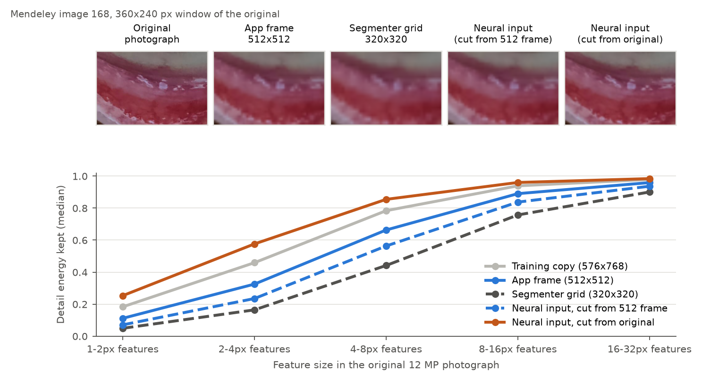

# Experiment 22: what resizing and squashing cost

**Result.** Resizing does not limit the mask and barely touches the colour. It does
remove fine structure, and most of that loss is in how the neural model's input is
built today.

- **Mask.** A perfect model working on the segmenter's 320×320 grid would still
  score Dice 0.992 against the full-resolution annotation, and 0.989 on the
  thinnest third of masks. Our models score about 0.845, so the grid accounts for
  at most about a twentieth of what they lose.
- **Colour.** At the 512×512 frame the app reads colour from, every colour
  feature moves by 2–4% of the spread between people on average. The order of
  people is unchanged (correlation with full resolution ≥ 0.999).
- **Structure.** In the 512×512 frame, features 2–4 pixels across (in the
  original photograph) keep about a third of their detail and features 4–8
  pixels across about two-thirds. The neural input is cut from that frame and
  then enlarged. Cutting the same 224×224 input from the original photograph
  would keep 1.5–2.4 times as much detail at 2–8 pixels, at no extra cost.

No model was trained or rescored. Everything here is measured on the annotators'
own masks, so no model's errors are mixed in.

## The question

Every photograph is resized at least twice before anything reads it. Because 97%
of the photographs are 3:4 portrait, every resize to a square also stretches them
1.33× sideways. The question was whether this destroys information, and if so
which kind: the mask, the colour, or the structure.

What the app does to a photograph (`src/anemia/preprocess.py`, `prepare`):

1. **Squash to 512×512.** The whole frame is squashed to 512×512 (area
   interpolation). A 3000×4000 photograph loses about 98% of its pixels.
2. **Segment on a 320×320 grid.** The segmenter squashes that again to 320×320
   and predicts a probability per pixel. The probability map is enlarged back to
   512×512 and thresholded there.
3. **Read colour.** Colour is read inside the mask from the 512×512 frame.
4. **Build the neural input.** The mask's bounding box is cut from the 512×512
   frame, padded to a square and resized to 224×224.

The training copies of the images are 576×768 (Mendeley) and 800×1067
(Eyes-defy). The Mendeley originals are 12 megapixels, and their masks were drawn
at that resolution. The Eyes-defy masks exist only at 800×1067. So colour and
structure are measured on the 547 Mendeley images, and the mask ceiling on all
648, with the two datasets reported separately.

## 1. Mask ceiling

The annotator's mask is shrunk to a grid, enlarged back, and scored against
itself at native resolution. No model can beat this on that grid.

- **Soft** keeps the fraction of each grid cell that is conjunctiva, which is
  what an ideal probability map would be. It is enlarged smoothly and thresholded
  at 0.5, which is how the app handles probabilities.
- **Hard** thresholds on the grid first and then enlarges the blocks.

| Grid | Mendeley soft | Mendeley hard | Eyes-defy soft | Eyes-defy hard |
|---|---|---|---|---|
| 224×224 | 0.988 | 0.948 | 0.996 | 0.975 |
| **320×320 (segmenter)** | **0.992** | 0.963 | **0.998** | 0.983 |
| 288×384 (3:4, about the same pixel count) | 0.993 | 0.967 | 0.998 | 0.983 |
| 512×512 | 0.996 | 0.977 | 1.000 | 0.987 |
| 576×768 | 0.997 | 0.983 | 1.000 | 0.989 |
| App path (320 probability → 512 → threshold) | 0.976 | | 0.987 | |
| Training labels (the 576×768 copies) | 0.964 | | 1.000 | |

Mean Dice per image. The 10th percentile is within 0.007 of the mean in every
soft row. The worst single image at 320 soft scores 0.972.

**Thin masks lose more, but not much.** Mendeley median mask thickness is 77
native pixels; the thinnest third is 13–67 pixels thick.

| Thickness | 320 soft | App path |
|---|---|---|
| Thinnest third | 0.989 | 0.966 |
| Middle third | 0.993 | 0.978 |
| Thickest third | 0.995 | 0.984 |

What this says:

- **The 320 grid is not what caps the segmenter.** The gap between our models
  (about 0.845) and perfect is about 0.15. The grid explains at most 0.008 of it,
  and a 3:4 grid of the same size gains only 0.001.
- **Enlarging probabilities before thresholding matters.** Thresholding on the
  grid first (hard) costs four to eight times as much. The app does it the better
  way.
- **In the app, the 512 frame caps the mask more than the 320 grid does** (0.976
  vs 0.992), because the mask is thresholded at 512. This matters less than it
  sounds: colour is read at 512 too, so the mask and the pixels it selects live on
  the same grid (Section 2).
- **This ceiling says nothing about whether more resolution helps a model *see*
  edges.** It only shows that the 320 grid can *represent* the right answer. Only
  training at a larger size can test the first.

**Side finding: the Mendeley training labels are slightly fatter than the
annotation**, in every image: area +1.6% median, +0.4% at least, Dice 0.964 against
the 12-megapixel annotation. A plain 576×768 resize would score 0.983. The extra
loss comes from `prepare_conjunctiva_seg.py`, which reads the masks at a quarter of
their resolution and counts any non-zero pixel as conjunctiva, so partly covered
edge pixels are included. The effect is small, but it points one way, towards
including neighbouring tissue. Nothing was changed.

## 2. Colour

The project's colour features were computed inside the annotator's mask on the
12-megapixel photograph, then again after each resize. Each shift is expressed as a
fraction of that feature's spread between people (its SD across the 547 images). A
shift that is small next to the difference between two people cannot move a
haemoglobin estimate much.

| Path | Mean shift, in between-person SD | Worst image | Correlation with native |
|---|---|---|---|
| Training copy, 576×768 | 0.015–0.026 | 0.24 | ≥ 0.9996 |
| **App frame, 512×512 (where the app reads colour)** | **0.020–0.038** | 0.27 | **≥ 0.9992** |
| Segmenter grid, 320×320 | 0.032–0.070 | 0.38 | ≥ 0.9980 |
| Neural input, cut from the 512 frame (current) | 0.032–0.071 | 0.39 | ≥ 0.9977 |
| Neural input, cut from the original | 0.012–0.022 | 0.22 | ≥ 0.9997 |
| Original pixels, mask from an ideal 320 model | 0.001–0.003 | 0.03 | 1.0000 |

Ranges are across the nine features (r and g chromaticity, log(R/G), log(R/B), a\*,
b\*, mean R, G, B).

- **Colour survives resizing.** At the app's 512 frame, the average shift is
  2–4% of the between-person spread, and people stay in the same order.
- **The shift has a direction.** Smaller images read slightly less red: a\* falls
  by 0.16 at 512 and 0.33 at 320, against a between-person SD of 8.3. Shrinking
  blends the edge pixels of a thin crescent with paler neighbouring tissue.
- **The cause is the image, not the mask.** The last row reads the original
  pixels through a mask taken from the 320 grid, and moves by 0.1–0.3% of the
  spread on average. So where the mask edge lands does not matter for colour. The blending
  comes from shrinking the image itself.
- **The shift is consistent across people**, so a model fitted on the same
  pipeline absorbs it as a constant. What would not be absorbed is training at one
  resolution and serving at another. So the rule is: the same preprocessing for
  fitting and for serving.

## 3. Structure

The green channel, where vessels have the most contrast, was shrunk and enlarged
back, then compared with the original inside the conjunctiva. The mask was eroded
by 8 pixels to stay off the blurred edge. Two measures:

- **SSIM**: 1 means identical.
- **Detail energy kept in each band of feature size**: if a band keeps 0.3, 70%
  of the variation at that size is gone from the image the network sees.

| Path | SSIM | 2–4 px | 4–8 px | 8–16 px | 16–32 px |
|---|---|---|---|---|---|
| Training copy, 576×768 | 0.931 | 0.46 | 0.78 | 0.94 | 0.98 |
| App frame, 512×512 | 0.912 | 0.33 | 0.66 | 0.89 | 0.96 |
| Segmenter grid, 320×320 | 0.885 | 0.16 | 0.44 | 0.76 | 0.90 |
| **Neural input, cut from the 512 frame (current)** | **0.904** | **0.24** | **0.56** | **0.84** | 0.94 |
| Neural input, cut from the original | 0.946 | 0.58 | 0.86 | 0.96 | 0.98 |

The table shows medians over 547 Mendeley images. Band sizes are in pixels of the
12-megapixel original. The 1–2 pixel band is left out of the table (it keeps
0.05–0.25): at that size the photograph is mostly sensor noise and demosaicing,
not tissue.

- **Fine structure is lost.** Whether vessel structure carries haemoglobin
  information is a separate question, for the haemoglobin model. This
  measurement shows only what is left for it to use.
- **The neural input is currently built the lossy way.** The crop box is a
  median 156×58 pixels in the 512 frame, so the 224×224 input is that crop
  *enlarged*. Its pixels are interpolated and add no detail. Cut from the
  original photograph instead, the same box is 923×452 pixels, and the 224×224
  input is a fourfold *reduction* that keeps real detail. Same input size, same
  cost, 1.5–2.4 times the detail at 2–8 pixels.
- **The crescent is stretched before it is padded.** The 512 squash stretches it
  1.33× sideways before `pad_to_square` runs. That function's docstring says the
  crescent shape is never stretched, which is true only relative to the
  already-squashed frame.

## How to justify the preprocessing in the report

| Question | Answer | Evidence |
|---|---|---|
| Does resizing limit the mask? | No | Ideal Dice 0.992 at 320 against full resolution; models are at about 0.845 |
| Does resizing change the colour? | Negligibly | 2–4% of between-person spread at 512; order of people preserved |
| Does resizing destroy structure? | Yes, fine structure | Features under 8 pixels keep a third to two-thirds of their detail at 512 |
| Does squashing distort shape? | Yes, 1.33× | 97% of photographs are 3:4; squashing to a square stretches them |

## What this changes

1. **The crop-before-segmentation idea is not justified by mask resolution**: the
   320 grid costs at most 0.008. It might still help the model see edges, but
   only training can test that.
2. **It is justified for the haemoglobin model's input.** Cutting the 224×224
   crop from the original photograph instead of the 512 frame keeps 1.5–2.4 times
   the fine detail and removes the 1.33× stretch, at no cost. Worth raising with
   Biraj if his ResNet uses this crop.
3. **Same preprocessing for fitting and serving.** Colour shifts with resolution
   by a small constant, which only matters if the two differ.
4. **Not measured, needs training:** training pads each image to a square and
   keeps its shape, while validation, test and the app squash it. The models are
   used on a geometry they were not trained on.

None of the pipeline code was changed.

## Limits

- **Measured on annotators' masks.** Model errors are deliberately excluded. A
  model's own mask boundaries were not rescored at full resolution.
- **Colour and structure use Mendeley only.** The Eyes-defy annotations were
  drawn at 800×1067, so there is no full-resolution reference for them.
- **Detail energy is not diagnostic value.** These measurements show what
  survives, not what matters for haemoglobin.
- **No physical scale.** The photographs carry no ruler and were taken at
  different distances, so feature sizes are in pixels, not micrometres.
- **Structure is measured on the green channel only.**

## Files

| File | What |
|---|---|
| `measure.py` | All three measurements; `--limit N` for a quick check (about 4 minutes in full) |
| `figure.py` | `report_figure.png`: one conjunctiva after each resize, and detail kept by band |
| `summary.json` | Every summary number above |
| `ceiling_per_image.csv` | Mask ceiling per image and grid, with mask thickness and coverage |
| `colour_per_image.csv` | Every colour feature per image and path |
| `structure_per_image.csv` | SSIM and band energy kept per image and path |
