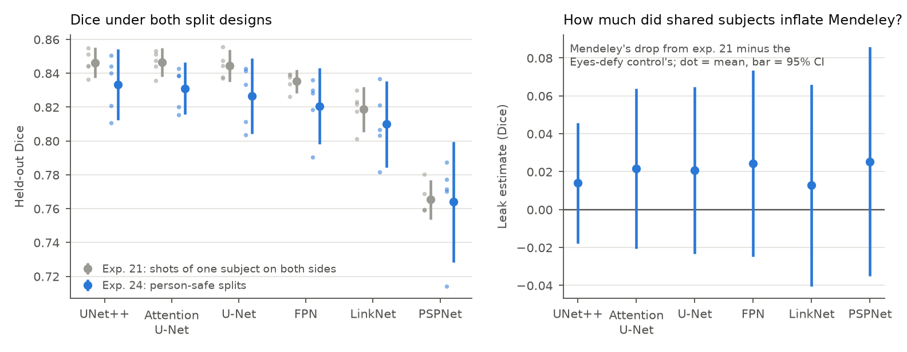

# Experiment 24: the architecture comparison on person-safe splits

Run: `python experiments/24_grouped_splits/run.py` (resumable; `--plan` prints the
five splits without training, `--evaluate-only` rescores existing bundles), then
`python experiments/24_grouped_splits/figure.py`.
Outputs: `per_split.csv` (one row per split × architecture, with Dice on each
source), `summary.csv`, `results.json` (everything, including both comparison
families and the leak estimate), `per_image_dice.npz` (with image names and
sources), `report_figure.png`. Bundles (`bundles/seed<N>/`) and training logs
(`logs/`) are not committed.

**Result.** Experiment 21 was repeated with splits that keep every photograph of
a subject, and its neighbours in capture order, on one side.

- **The order holds.** The U-Net family is on top (UNet++ 0.833, Attention U-Net
  0.831, U-Net 0.826), then FPN (0.821), then LinkNet (0.810). PSPNet (0.764) is
  last in every split. LinkNet is not first in any split, here or in experiment 21.
- **LinkNet's deficit is smaller, and no longer significant.** It is −0.017 Dice
  against U-Net (was −0.026), −0.023 against UNet++ and −0.011 against FPN. None
  of its comparisons survives Holm correction. So the published claim that LinkNet
  is best is still not reproduced, but our evidence that it is *worse* than the
  U-Net family is weaker than experiment 21 suggested.
- **Nothing beats Attention U-Net**, the selected architecture. It stays tied with
  UNet++ and U-Net.
- **The leak probably cost a little, and we cannot pin it down.** Under the new
  splits every architecture lost 0.006–0.021 Dice on Mendeley, while the Eyes-defy
  control did not fall (−0.001 to +0.020). The leak estimate is +0.013 to +0.025 Dice for all six, but
  every 95% interval includes zero.
- **Person-safe splits are noisier.** Split-to-split SD roughly doubled (0.012–0.029,
  against 0.006–0.011), because each test set is now a few runs of consecutive
  photographs rather than a random sprinkle across the whole set.

## The question

Experiment 23 found that the 547 Mendeley images are repeat shots: at least 463 of
them fall into 115 groups, so there are at most 199 subjects and probably far
fewer. In every split of experiment 21, 64–72% of test images had a photograph of
the same subject in training. A model that trained on one shot partly recognises
the others, so those test scores may partly measure recognition, not
generalisation. Two questions follow:

1. **Does the architecture comparison survive** once no subject straddles the
   split? In particular, is LinkNet still below the U-Net family?
2. **How much did the leak inflate** experiment 21's scores?

## Method

Everything is as in experiment 21 except the split:

- six architectures, ImageNet EfficientNet-B0 encoder, 320 px, rotation
  augmentation, 40 epochs;
- epoch chosen on validation Dice, then scored once on test;
- random states 0, 1, 2, 3 and 42 (30 models, about 16 hours of training over
  two sessions).

**The split** (`scripts/train_segmenter.py`, `split_subjects`; options
`--groups experiments/23_duplicates/groups.csv --block 24 --buffer 4`):

- **Groups.** Every image in one of experiment 23's 115 groups belongs to one
  unit. A unit is never cut.
- **Blocks.** Mendeley units are sorted by file number and cut into runs of at
  least 24 images. The first run's length is random per seed. The runs are
  shuffled and dealt out to test and validation (20% of images each) and training.
  This is needed because experiment 23 found that neighbouring groups are often
  the same person (the other eye, or a re-framed shot that SIFT did not link).
  Consecutive runs keep those together without having to find them.
- **Buffer.** Any Mendeley image within 4 file numbers of a test image, together
  with its whole group, is left out of training and validation. This guards the
  edge of each run.
- **Per-source shares.** Each dataset contributes its own 20% to test, so every
  test set has 20 Eyes-defy subjects. Eyes-defy subjects are named, one image
  each, and are dealt out individually.

Checked on the real data: no test image has a group partner in training or
validation, and no training or validation image is within 4 file numbers of a test
image.

| seed | train | validation | test (Mendeley + Eyes-defy) | left out by the buffer |
|---|---|---|---|---|
| 0 | 339 | 134 | 140 (120 + 20) | 35 |
| 1 | 344 | 129 | 118 (98 + 20) | 57 |
| 2 | 348 | 140 | 122 (102 + 20) | 38 |
| 3 | 345 | 138 | 124 (104 + 20) | 41 |
| 42 | 366 | 133 | 121 (101 + 20) | 28 |

Experiment 21 trained on 390 images per split; training here has 24–51 fewer,
almost all of them Mendeley, lost to the buffer and to the coarser units.

**The leak estimate.** Eyes-defy is the control. Its subjects are named, one image
each, so it had no relatives in training in either experiment. Anything that moves
both sources alike, such as a smaller training set or a different split design,
moves the gap between them very little. A leak raises only Mendeley. So:

leak estimate = (Mendeley − Eyes-defy) in experiment 21 − (Mendeley − Eyes-defy) here,

with a Welch interval from the five per-split gaps of each experiment.

## Results

### Dice

| architecture | mean | SD | min | max | 95% CI of mean | experiment 21 |
|---|---|---|---|---|---|---|
| **UNet++** | **0.8333** | 0.0169 | 0.8106 | 0.8507 | [0.8123, 0.8543] | 0.8462 ± 0.0072 |
| Attention U-Net | 0.8311 | 0.0123 | 0.8154 | 0.8427 | [0.8158, 0.8464] | 0.8464 ± 0.0069 |
| U-Net | 0.8265 | 0.0179 | 0.8036 | 0.8429 | [0.8042, 0.8487] | 0.8445 ± 0.0076 |
| FPN | 0.8206 | 0.0181 | 0.7904 | 0.8360 | [0.7982, 0.8430] | 0.8353 ± 0.0055 |
| LinkNet | 0.8099 | 0.0206 | 0.7816 | 0.8366 | [0.7843, 0.8355] | 0.8187 ± 0.0108 |
| PSPNet | 0.7640 | 0.0287 | 0.7141 | 0.7873 | [0.7284, 0.7997] | 0.7654 ± 0.0094 |

### IoU and pixel accuracy

| architecture | IoU | pixel accuracy |
|---|---|---|
| UNet++ | 0.7218 ± 0.0227 | 0.9950 ± 0.0002 |
| Attention U-Net | 0.7192 ± 0.0161 | 0.9949 ± 0.0004 |
| U-Net | 0.7124 ± 0.0227 | 0.9949 ± 0.0003 |
| FPN | 0.7036 ± 0.0230 | 0.9946 ± 0.0006 |
| LinkNet | 0.6895 ± 0.0259 | 0.9943 ± 0.0005 |
| PSPNet | 0.6308 ± 0.0319 | 0.9932 ± 0.0008 |
| *all background* | | *0.9846 ± 0.0003* |

Mean ± SD across the five splits. As in experiment 21, pixel accuracy cannot
separate the models: predicting background everywhere already scores 0.985.

### Precision, recall and boundary

| architecture | precision | recall | HD95 px (median) | experiment 21 HD95 |
|---|---|---|---|---|
| UNet++ | 0.820 ± 0.034 | 0.865 ± 0.033 | **3.3** ± 0.3 | 2.2 |
| Attention U-Net | 0.824 ± 0.024 | 0.854 ± 0.027 | 3.5 ± 0.4 | 2.5 |
| U-Net | **0.825** ± 0.022 | 0.844 ± 0.046 | 3.4 ± 0.4 | 2.6 |
| FPN | 0.806 ± 0.032 | 0.855 ± 0.031 | 3.4 ± 0.4 | 2.9 |
| LinkNet | 0.767 ± 0.037 | **0.880** ± 0.020 | 3.6 ± 0.4 | 3.0 |
| PSPNet | 0.730 ± 0.041 | 0.829 ± 0.053 | 5.5 ± 0.4 | 4.4 |

LinkNet still spills. It has the highest recall and the lowest precision of the
top five, the same pattern as in experiment 21. Boundary error rose by about 1 px
for every architecture.

> Experiment 25 rescored these 30 models with F0.5, which weights precision twice
> as much as recall, and chose each model's mask threshold on its validation
> images. At the usual threshold of 0.5 the order is the same and LinkNet's gap
> to Attention U-Net doubles (−0.043, not significant). At the chosen thresholds
> (about 0.97) LinkNet's precision rises to 0.88 and the gap shrinks to −0.014:
> much of the spill is where 0.5 falls for it.

### Rank within each split

| split (seed) | 1st | 2nd | 3rd | 4th | 5th | 6th |
|---|---|---|---|---|---|---|
| 0 | UNet++ | Attention U-Net | U-Net | FPN | LinkNet | PSPNet |
| 1 | Attention U-Net | U-Net | UNet++ | FPN | LinkNet | PSPNet |
| 2 | UNet++ | U-Net | Attention U-Net | FPN | LinkNet | PSPNet |
| 3 | UNet++ | U-Net | Attention U-Net | LinkNet | FPN | PSPNet |
| 42 | UNet++ | Attention U-Net | FPN | LinkNet | U-Net | PSPNet |

Mean rank: UNet++ 1.4, Attention U-Net 2.2, U-Net 2.8, FPN 4.0, LinkNet 4.6,
PSPNet 6.0. PSPNet is still last every time. The boundaries between the other
groups are no longer fixed: LinkNet was fourth twice, and U-Net fell to fifth in
seed 42.

## Comparisons

The same corrected resampled t-test and the same two families as experiment 21,
each Holm-corrected. Here n_test / n_train = 125 / 348, so the variance factor is
(1/5 + 0.36) = 0.56.

### The published claim: LinkNet against the four it reportedly beat

| pair | mean Dice diff | corrected 95% CI | p | p Holm | splits LinkNet ahead | experiment 21 |
|---|---|---|---|---|---|---|
| LinkNet − U-Net | −0.0166 | [−0.0479, +0.0147] | 0.215 | 0.430 | 1 / 5 | −0.0258, Holm 0.030 |
| LinkNet − UNet++ | −0.0234 | [−0.0486, +0.0018] | 0.061 | 0.184 | 0 / 5 | −0.0275, Holm 0.047 |
| LinkNet − FPN | −0.0107 | [−0.0316, +0.0101] | 0.226 | 0.430 | 1 / 5 | −0.0166, Holm 0.047 |
| LinkNet − PSPNet | +0.0458 | [+0.0129, +0.0787] | 0.018 | 0.072 | 5 / 5 | +0.0533, Holm 0.019 |

### Does anything beat the current choice, Attention U-Net?

| pair | mean Dice diff | corrected 95% CI | p | p Holm | splits ahead |
|---|---|---|---|---|---|
| UNet++ − Attention U-Net | +0.0022 | [−0.0080, +0.0124] | 0.58 | 0.90 | 4 / 5 |
| U-Net − Attention U-Net | −0.0046 | [−0.0200, +0.0108] | 0.45 | 0.90 | 2 / 5 |
| FPN − Attention U-Net | −0.0105 | [−0.0304, +0.0094] | 0.22 | 0.65 | 0 / 5 |
| LinkNet − Attention U-Net | −0.0212 | [−0.0501, +0.0077] | 0.11 | 0.45 | 0 / 5 |
| PSPNet − Attention U-Net | −0.0670 | [−0.1113, −0.0228] | 0.014 | 0.068 | 0 / 5 |

Nothing beats Attention U-Net. UNet++ was ahead in four splits by an average of
0.002, well inside the noise.

### Why significance was lost

There are two reasons, and the second is larger.

1. **The gaps shrank.** LinkNet − U-Net went from −0.026 to −0.017, LinkNet − FPN
   from −0.017 to −0.011. The change itself is not significant (Welch p
   0.27–0.59 for the four LinkNet gaps). We cannot tell whether removing the leak
   narrowed them or the new splits simply landed differently.
2. **The paired differences became twice as variable.** The SD of LinkNet − U-Net
   across splits went from 0.008 to 0.015. A test set made of a few capture
   sessions is a harder and more variable draw than a random 20% of all photographs.
   Each split asks how the models do on *those* sessions, and the models disagree
   more about which sessions are hard.

**More splits would not settle it.** The corrected variance factor is
1/J + n_test/n_train. The second term (0.36) does not shrink with more splits,
because it accounts for the training sets overlapping. With the observed
LinkNet − U-Net gap and spread, 10 splits would give p ≈ 0.14 and 20 splits
p ≈ 0.10. Resolving a gap of 0.01–0.02 at this spread would need a lower-variance
design, for example blocked k-fold cross-validation, where every image is tested
exactly once per repeat, or much more data.

## Did the leak inflate experiment 21?

| architecture | all images: 21 → 24 | Mendeley: 21 → 24 | Eyes-defy: 21 → 24 | leak estimate [95% CI] |
|---|---|---|---|---|
| U-Net | 0.8445 → 0.8265 | 0.8464 → 0.8253 | 0.8321 → 0.8317 | +0.021 [−0.023, +0.065] |
| UNet++ | 0.8462 → 0.8333 | 0.8482 → 0.8331 | 0.8345 → 0.8334 | +0.014 [−0.018, +0.046] |
| Attention U-Net | 0.8464 → 0.8311 | 0.8490 → 0.8306 | 0.8292 → 0.8325 | +0.022 [−0.020, +0.064] |
| LinkNet | 0.8187 → 0.8099 | 0.8178 → 0.8069 | 0.8236 → 0.8255 | +0.013 [−0.040, +0.066] |
| FPN | 0.8353 → 0.8206 | 0.8374 → 0.8192 | 0.8209 → 0.8270 | +0.024 [−0.025, +0.073] |
| PSPNet | 0.7654 → 0.7640 | 0.7653 → 0.7594 | 0.7672 → 0.7867 | +0.025 [−0.035, +0.086] |

**What a leak would look like, and does.** Mendeley fell for every architecture
(0.011–0.021 for the top five). Eyes-defy, which had nothing to leak, moved by only
−0.001 to +0.006 for the top five. All six estimates are positive, at +0.013 to +0.025.

**Why it is not established.**

- Every interval spans zero. The Eyes-defy part of each test set is only 20
  images, and the Mendeley part is a few sessions, so the per-split gaps swing
  widely (for U-Net, from −0.053 to +0.046).
- The six estimates are not six pieces of evidence. All architectures share the
  same five splits, so they rise and fall together.
- The estimate is biased upward. Training shrank by 24–51 images, almost all
  Mendeley, which is likely to hurt Mendeley test images more than Eyes-defy
  ones. The control does not remove that.

**Together with experiment 23.** That experiment compared, within experiment 21,
Mendeley test images with and without a relative in training, and found
+0.003 to +0.010. Both estimates fit a small inflation, of order 0.01–0.02 Dice,
that left the ranking largely in place. Neither excludes zero.

## Two side observations

**Models now stop improving earlier.** The best validation epoch came earlier
for five of six architectures (median epoch, experiment 21 → 24):

| architecture | median best epoch |
|---|---|
| Attention U-Net | 29 → 18 |
| UNet++ | 30 → 27 |
| U-Net | 30 → 24 |
| FPN | 34 → 23 |
| LinkNet | 38 → 32 |
| PSPNet | 33 → 32 |

The mean over all 30 models fell from 32 to 27 epochs. A smaller training set
means fewer steps per epoch, which should push the best epoch *later*. So this
fits the leak having flattered the validation curve in experiment 21: with repeat
shots of training subjects in the validation set, fitting the training subjects
more closely kept looking like progress. This is consistent with the leak, not
proof of it. Experiment 21's observation that LinkNet "peaks late" (median epoch
38) is weaker here (32).

**Validation Dice no longer predicts test Dice.** In experiment 21, validation
Dice exceeded test Dice in all 30 models (by +0.0135 on average, the optimism of
choosing the epoch on validation). Here it does so in 12 of 30, with a mean gap
of −0.002. Validation and test are now different sessions, and how hard a session
is outweighs the selection optimism. Per split, the six models move together: the
validation sessions were easier than the test sessions in seeds 1 and 42, and
harder in seeds 0, 2 and 3.

## What this changes

1. **Lead with these numbers, not experiment 21's, for new subjects.** For the
   deployed architecture, person-safe Dice is 0.831 ± 0.012 (Attention U-Net),
   against 0.846 ± 0.007 when shots of one subject could straddle the split.
   Experiment 21 remains the tighter comparison between architectures *on this
   data*. Experiment 24 is the fairer estimate of performance on people the model
   has not seen.
2. **The LinkNet sentence needs softening.** Still true: LinkNet is never best in
   ten splits, beats only PSPNet, and spills onto surrounding tissue. Not
   supported any more: "significantly worse than U-Net, UNet++ and FPN". Say
   "lower in most splits, not significantly so on person-safe splits".
3. **The architecture choice does not change.** Attention U-Net, UNet++ and U-Net
   remain tied. Experiment 21's grouping into a top three and a bottom three is
   softer here: PSPNet is clearly last, while FPN and LinkNet overlap with the
   U-Net family in some splits.
4. **A methods point for the report.** Splitting by image on data with repeat
   shots made the comparison look sharper than it is. That is the same risk we
   raised for the published comparison (augmentation before the split), measured
   on our own data.

## Limits

- **Groups are an approximation of people.** SIFT links repeat shots of one eye.
  The blocks and buffer are a proxy for "same person, other eye", based on capture
  order and checked by eye on 24 group boundaries. A person whose photographs are
  far apart in file order would still straddle the split. Experiment 23 found no
  sign of that, but it was not designed to.
- **Fewer training images.** Training fell from 390 to 339–366 images. This lowers
  every score a little, and Mendeley's more than Eyes-defy's (see the bias above).
- **Five splits, 20 Eyes-defy test images each.** The control is small, which is
  why the leak intervals are wide.
- **Everything else as experiment 21.** One configuration per architecture, one
  encoder, 40 epochs, the same two datasets. Still not a test on a new camera.

## Files

| file | what |
|---|---|
| `run.py` | trains (resumable) and scores the 30 models, prints all tables |
| `figure.py` | `report_figure.png` from the outputs here and in experiment 21 |
| `per_split.csv` | one row per split × architecture: sizes, Dice per source, all metrics, best epoch, validation Dice |
| `summary.csv` | mean, SD, variance, min, max, 95% CI per metric and architecture |
| `results.json` | the above, plus both comparison families, the split settings (groups file hash, block, buffer) and the leak estimate with per-split gaps |
| `per_image_dice.npz` | per-image Dice with image names and sources, per split and architecture |
