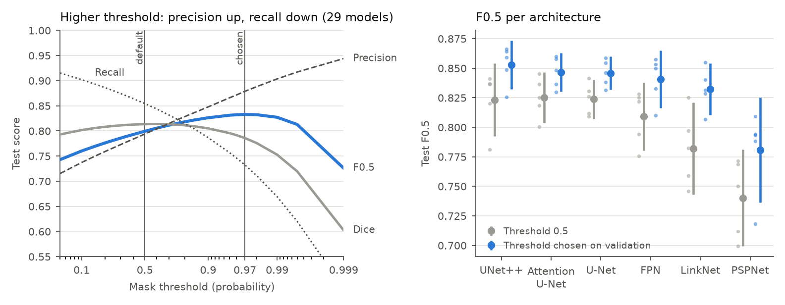

# Precision-Weighted Scoring and the Mask Threshold

Run: `python experiments/25_precision_weighted/run.py`, then `figure.py`
Outputs: `per_split.csv`, `results.json`, `pixel_counts.npz` (true-positive,
false-positive and false-negative pixels for every image, model and threshold),
`per_image_f05.npz`, `report_figure.png`.

## Result

- **Under F0.5 at the usual threshold of 0.5, the order is the same as under
  Dice.** Attention U-Net 0.825, U-Net 0.824, UNet++ 0.823, FPN 0.809, LinkNet
  0.782, PSPNet 0.740. LinkNet's gap to Attention U-Net doubles (−0.043, against
  −0.021 in Dice) because it over-segments most, but it still does not survive
  correction (Holm p 0.30).
- **For F0.5 the best threshold is far above 0.5:** about 0.97 (0.85–0.995) in
  29 of the 30 models. A threshold chosen on validation images raised test F0.5
  in all 29 of those models, by +0.021 to +0.050 per architecture. In exchange,
  precision rises by 0.06–0.12 (to 0.88–0.89 for all but PSPNet), recall falls
  from about 0.85 to 0.71–0.77, Dice falls by 0.018–0.033, and masks shrink from
  about the true size to 79–86% of it.
- **Weighting precision is what moves the threshold.** When the threshold is
  chosen for Dice instead, the chosen values scatter between 0.15 and 0.9 and
  test Dice gains nothing (−0.001 to +0.002). So 0.5 is already right for Dice.
- **Once each model gets its own threshold, the middle of the table closes up.**
  UNet++ 0.853, Attention U-Net 0.846, U-Net 0.846, FPN 0.841, LinkNet 0.832,
  PSPNet 0.781. LinkNet's deficit to Attention U-Net shrinks from −0.043 to
  −0.014, and FPN's from −0.016 to −0.006. Much of their shortfall at 0.5 was
  over-segmentation, which a stricter threshold removes. Nothing beats
  Attention U-Net (UNet++ +0.006, Holm p 1.0), and PSPNet is last in every split
  under every score.
- **The threshold belongs to a trained model, not to an architecture.** One
  Attention U-Net (seed 0) never outputs a probability above 0.53. For that
  model no threshold above 0.5 works, while the other 29 models reach 1.0. A
  number copied from this table therefore cannot be assumed to suit a newly
  trained model.

## The question

The extractor's mask decides which pixels the haemoglobin model reads. A pixel
wrongly included (eyelid skin, sclera, a lash, glare) pulls the measured colour
toward the wrong tissue. A pixel wrongly left out only removes some conjunctiva,
and the rest still reads roughly the same colour. Dice counts both errors
equally.

The precision-weighted version of Dice already exists: the F-beta score. Dice is
its beta = 1 case.

```
F0.5 = 1.25 TP / (1.25 TP + 0.25 FN + FP)
```

With beta = 0.5, precision weighs twice as much as recall. It is also the
Tversky index with weight 0.8 on false positives and 0.2 on false negatives.
The weight was fixed at the conventional 0.5 before any model was rescored. It
was not chosen by trying several values.

Every architecture in experiment 24 had recall above precision at 0.5, so all of
them lean toward over-segmenting there. Raising the threshold trades recall for
precision without any retraining. Two questions follow: does the ranking change
under F0.5, and does it change once every model is given its best threshold?

## Method

- **Models:** the 30 models of experiment 24 (six architectures × five
  person-safe splits), as saved. Nothing was trained.
- **Masks:** each model's raw output at every threshold in 0.05, 0.10, …, 0.95,
  0.96, 0.97, 0.98, 0.99, 0.995, 0.999, with no clean-up, as in experiments 20–24.
  - The first grid stopped at 0.95.
  - The first model scored chose 0.95 on its validation images, an edge of that
    grid, so the grid was extended before any other model was scored.
  - In the final run no model chose the top value (0.999).
- **Scoring:** per image, then averaged over images, the same convention as Dice
  in experiments 20–24.
- **Choosing the threshold:** for each model, the threshold with the highest mean
  F0.5 on that split's validation images. The test images are then scored at it,
  so the test set never influences the choice. The validation images are the
  ones that already chose each model's best epoch; using them for one more
  setting is the usual practice.
- **Control:** the same procedure with Dice in place of F0.5.
- **Statistics:** as in experiments 21 and 24.
  - Mean over the five splits with a 95% interval, and rank within each split.
  - The corrected resampled t-test on per-split scores (n_train 348, n_test 125).
  - Holm correction within each family.
  - Families: experiment 20's two, plus "chosen threshold minus 0.5", with one
    test per architecture.
- **Check:** Dice, precision and recall at 0.5 match experiment 24's
  `per_split.csv` exactly (largest difference 0).

## Results

### Test scores, mean over five person-safe splits

| Architecture | Dice at 0.5 | F0.5 at 0.5 | Threshold chosen (per split) | F0.5 at chosen | Dice at chosen |
|---|---|---|---|---|---|
| UNet++ | 0.833 | 0.823 [0.792, 0.854] | 0.99, 0.98, 0.95, 0.97, 0.97 | **0.853** [0.832, 0.873] | 0.810 |
| Attention U-Net | 0.831 | **0.825** [0.804, 0.847] | 0.50, 0.98, 0.98, 0.98, 0.98 | 0.846 [0.830, 0.863] | 0.809 |
| U-Net | 0.826 | 0.824 [0.807, 0.840] | 0.99, 0.96, 0.85, 0.98, 0.95 | 0.846 [0.832, 0.860] | 0.802 |
| FPN | 0.821 | 0.809 [0.780, 0.838] | 0.96, 0.96, 0.97, 0.96, 0.98 | 0.841 [0.816, 0.865] | 0.788 |
| LinkNet | 0.810 | 0.782 [0.743, 0.821] | 0.995, 0.97, 0.95, 0.97, 0.98 | 0.832 [0.810, 0.854] | 0.778 |
| PSPNet | 0.764 | 0.740 [0.699, 0.781] | 0.96, 0.95, 0.97, 0.90, 0.90 | 0.781 [0.736, 0.825] | 0.746 |

The threshold chosen on validation lands close to the one that would have been
best on the test images: on average 0.02 away, at most 0.12.

### What the chosen threshold does to the masks (test, at 0.5 → at the chosen threshold)

| Architecture | Precision | Recall | Mask area / true area (median) | Empty masks |
|---|---|---|---|---|
| UNet++ | 0.820 → 0.894 | 0.865 → 0.758 | 1.06 → 0.86 | 0 → 1 |
| Attention U-Net | 0.824 → 0.883 | 0.854 → 0.767 | 1.00 → 0.84 | 0 → 2 |
| U-Net | 0.825 → 0.884 | 0.844 → 0.751 | 1.02 → 0.86 | 0 → 0 |
| FPN | 0.806 → 0.893 | 0.855 → 0.725 | 1.05 → 0.82 | 0 → 1 |
| LinkNet | 0.767 → 0.883 | 0.880 → 0.714 | 1.12 → 0.79 | 0 → 0 |
| PSPNet | 0.730 → 0.821 | 0.829 → 0.712 | 1.11 → 0.85 | 0 → 2 |

At 0.5 the masks are about the true size, or larger for the architectures that
over-segment. At the chosen threshold they cover about five-sixths of the true
region. Six of the 3,750 test masks become empty, and in the app an empty mask
means the photo is rejected.

### Rank within each split

| Architecture | Dice at 0.5 | F0.5 at 0.5 | F0.5 at chosen |
|---|---|---|---|
| UNet++ | 1.4 (first 4×) | 2.2 (1×) | 1.4 (4×) |
| Attention U-Net | 2.2 (1×) | 2.0 (2×) | 2.4 (0×) |
| U-Net | 2.8 | 2.4 (2×) | 3.0 (1×) |
| FPN | 4.0 | 3.6 | 3.4 |
| LinkNet | 4.6 | 4.8 | 4.8 |
| PSPNet | 6.0 | 6.0 | 6.0 |



*Left: as the threshold rises, precision climbs and recall falls. Dice is flat
around 0.5 and falls only late, while F0.5 keeps rising to a peak near 0.97.
The curves are averaged over the 29 models whose probabilities reach 1, and the
x-axis is stretched near 0 and 1 because the trade happens between 0.9 and
0.999. Right: each architecture's test F0.5 at 0.5 (grey) and at its
validation-chosen threshold (blue). Small dots are single splits; the larger dot
and bar are the mean and its 95% interval.*

### Comparisons on test F0.5 (corrected resampled t-test, Holm within each family)

| Pair | At 0.5: difference, Holm p | At chosen threshold: difference, Holm p | Splits the first was ahead (chosen) |
|---|---|---|---|
| LinkNet − U-Net | −0.042, 0.24 | −0.014, 0.25 | 1 of 5 |
| LinkNet − UNet++ | −0.041, 0.14 | −0.020, 0.08 | 0 of 5 |
| LinkNet − FPN | −0.027, 0.30 | −0.008, 0.25 | 0 of 5 |
| LinkNet − PSPNet | +0.042, 0.30 | +0.052, 0.09 | 5 of 5 |
| U-Net − Attention U-Net | −0.001, 1.0 | −0.001, 1.0 | 2 of 5 |
| UNet++ − Attention U-Net | −0.002, 1.0 | +0.006, 1.0 | 4 of 5 |
| LinkNet − Attention U-Net | −0.043, 0.30 | −0.014, 0.45 | 0 of 5 |
| FPN − Attention U-Net | −0.016, 0.30 | −0.006, 1.0 | 1 of 5 |
| PSPNet − Attention U-Net | −0.085, **0.025** | −0.066, 0.16 | 0 of 5 |

The only comparison that resolves is PSPNet against Attention U-Net at 0.5. At
the chosen thresholds it no longer resolves, mainly because the seed-0
Attention U-Net could not raise its threshold (see below) and the spread grew.
PSPNet is still last in every split.

### What the chosen threshold buys and costs, per architecture

| Architecture | Test F0.5 gain | Holm p | Test Dice change | Holm p |
|---|---|---|---|---|
| U-Net | +0.022 [+0.000, +0.044] | 0.19 | −0.025 | 0.18 |
| UNet++ | +0.030 [+0.003, +0.057] | 0.19 | −0.024 | 0.18 |
| Attention U-Net | +0.021 [−0.012, +0.054] | 0.25 | −0.023 | 0.38 |
| LinkNet | +0.050 [+0.016, +0.085] | 0.09 | −0.032 | 0.32 |
| FPN | +0.032 [−0.007, +0.070] | 0.25 | −0.033 | 0.38 |
| PSPNet | +0.040 [−0.012, +0.093] | 0.25 | −0.018 | 0.38 |

Taken one architecture at a time, no gain survives Holm. This is the five-split
power limit met in experiment 24: the n_test/n_train term in the corrected
variance does not shrink with more splits. The stronger evidence is consistency:
test F0.5 rose in every one of the 29 models whose threshold moved, by +0.008 to
+0.081. The LinkNet models gain most because they over-segment most. The
Attention U-Net row includes the seed-0 model, which stayed at 0.5; in the other
four splits its gain averages +0.027 and its Dice cost −0.028.

### Control: the threshold chosen for Dice

| Architecture | Threshold chosen for validation Dice (per split) | Test Dice change against 0.5 |
|---|---|---|
| UNet++ | 0.75, 0.70, 0.15, 0.50, 0.35 | −0.000 |
| Attention U-Net | 0.50, 0.55, 0.45, 0.30, 0.70 | −0.000 |
| U-Net | 0.80, 0.20, 0.15, 0.65, 0.15 | +0.002 |
| FPN | 0.55, 0.45, 0.45, 0.45, 0.70 | −0.001 |
| LinkNet | 0.90, 0.70, 0.45, 0.75, 0.90 | +0.002 |
| PSPNet | 0.60, 0.55, 0.60, 0.45, 0.55 | +0.001 |

All of these have Holm p 1.0. For Dice the curve is flat around 0.5, so the
chosen value wanders without changing the score. The high F0.5 threshold is
therefore the price of weighting precision, not a sign that 0.5 was a poor
default.

## Two side observations

**One model's probabilities never reach 1.** In the seed-0 Attention U-Net, the
conjunctiva's logits (scores before the sigmoid) stop at about 0.13, a
probability of 0.53, while background still reaches about −14. Every one of the
other 29 models marks pixels even at a threshold of 0.999.
- The model segments well at 0.5: test Dice 0.838, second in its split.
- At every threshold from 0.55 up its masks are empty, so its threshold could
  not move and its F0.5 at "chosen" equals its F0.5 at 0.5.
- The cause is not known. It is a property of that training run, not of the
  architecture: the other four Attention U-Nets reach 1.0 and chose 0.98.
- The practical lesson is that a threshold has to be chosen for each trained
  model on its own held-out images. It cannot be copied from a table like this.

**Why the best threshold is so close to 1.** The trainer's loss is cross-entropy
plus soft Dice (`scripts/train_segmenter.py`). Soft Dice is known to push pixel
probabilities toward 0 and 1. Precision and recall are still changing between
0.9 and 0.999, so many pixels near the boundary sit at probabilities above 0.9.
That is why the figure uses a stretched axis.

## What this changes

- **A metric for the report:** F0.5 measures what the extractor is for, and it
  is a standard score rather than an invented one. Dice should stay the main
  number because published work reports it. F0.5 sits beside it, together with
  the reason for weighting precision.
- **The architecture choice does not change.** Under F0.5, at 0.5 or at chosen
  thresholds, nothing beats Attention U-Net. At the chosen thresholds UNet++ is
  nominally highest, as it is under Dice.
  LinkNet is never first in any split under any score, so the published claim is
  still not reproduced. Its shortfall shrinks, though, once thresholds are
  tuned. Say "LinkNet over-segments at 0.5", not "LinkNet cannot find the
  conjunctiva".
- **The deployed threshold (0.5) has not been changed.** If precision is to be
  favoured, the shipped extractor needs its own threshold chosen on its own
  held-out images; the side observation above shows why it cannot simply be set
  to 0.97. Before changing it:
  - The crop given to the haemoglobin model would cover about five-sixths of the
    true region, so the haemoglobin model should be trained on crops made at the
    same threshold it will be served. This is the same match between training
    and serving that experiment 20 found for white balance, and it is a decision
    for the haemoglobin side.
  - Smaller masks reach the app's minimum mask size more often, so the rejection
    rate should be checked on real captures.

## Limits

- **The weight is a convention.** Beta = 0.5 was fixed in advance but not derived
  from what a wrong pixel costs. The best threshold depends on beta: Dice
  (beta = 1) is best near 0.5, F0.5 near 0.97.
  - Measuring how much one wrongly included pixel shifts the region's colour,
    compared with one missed pixel, would ground the weight.
  - Measuring colour error directly (mean colour inside the predicted mask
    against inside the true mask) would avoid needing a weight at all.
- **Pixel counts treat all false positives alike.** A wrong pixel on tissue that
  looks like conjunctiva and a wrong pixel on a lash count the same. A colour
  error measure would tell them apart.
- **Same five splits as experiment 24**, with the same power limit. Per
  architecture, the threshold's gain is consistent but not formally resolved.
- **Raw network output.** The deployed extractor also fills holes in the mask,
  which adds glare spots back and would lower precision a little. These scores
  describe the networks, as in experiments 20–24.
- **The grid is coarse below 0.95.** For the seed-0 Attention U-Net, values
  between 0.50 and 0.53 were not tried.
- **Validation images are used twice**, once for the epoch and once for the
  threshold. The test images are untouched, and the chosen thresholds land close
  to the test optimum.

## Files

- `run.py`: scores every model at every threshold, chooses thresholds, runs the
  statistics. Pixel counts are reused from `pixel_counts.npz` when the grid is
  unchanged; `--rescore` runs the models again.
- `figure.py`: draws `report_figure.png`.
- `per_split.csv`: one row per model, with the threshold, scores at 0.5 and at
  the chosen threshold, mask size, empty masks and the Dice control.
- `results.json`: summaries, ranks, mean curves and every comparison.
- `pixel_counts.npz`: true-positive, false-positive and false-negative pixels
  per image, model and threshold, for test and validation.
- `per_image_f05.npz`: per-image test F0.5 at 0.5 and at the chosen threshold.
